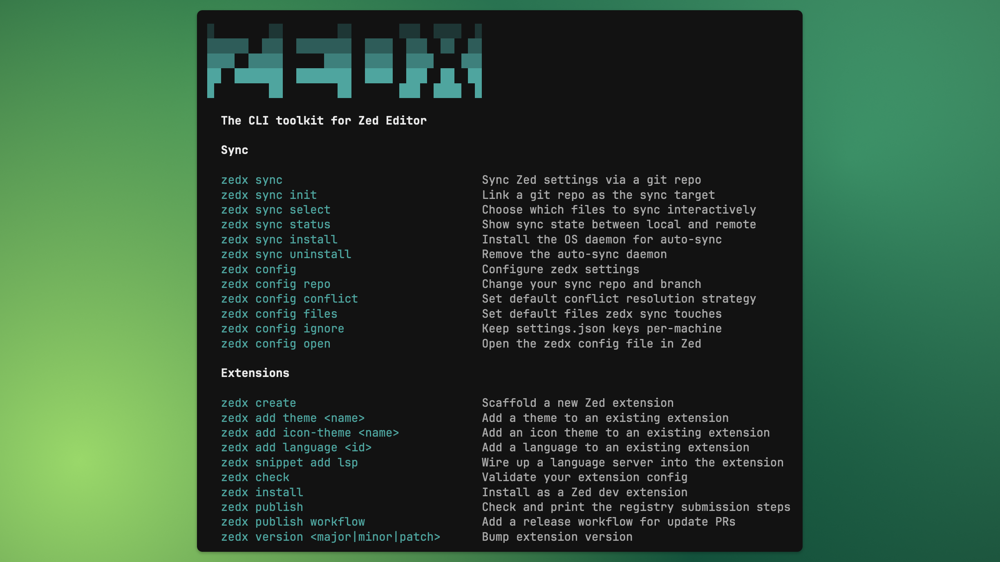

<p align="center">

</p>

<p align="center"> CLI toolkit for the Zed Editor</p>

<p align="center">
<a href="#installation">Installation</a> ·
<a href="#sync">Sync</a> ·
<a href="#scaffolding-an-extension">Extensions</a> ·
<a href="#validation">Validation</a> ·
<a href="#publishing">Publishing</a> ·
<a href="#configuration">Configuration</a> ·
<a href="#license">License</a>
</p>



## Installation

```bash
npm install -g zedx

# or
brew install tahayvr/tap/zedx
```

## Usage

### Sync

Sync your Zed config across machines using a private Git repo as the source of truth.

**1. Link a repo (one-time setup)**

```bash
zedx sync init
```

If the [GitHub CLI](https://cli.github.com) (`gh`) is installed and logged in, zedx offers to create a new private repo for you (named `zed-config` by default). Otherwise, or if you choose an existing repo, it prompts for a Git repo URL (SSH or HTTPS) and a branch name (defaults to `main`). The repo is saved to `~/.config/zedx/config.json`. No files are synced yet.

> [!NOTE]
> `settings.json`, `keymap.json`, `tasks.json`, `debug.json`, the user-global `AGENTS.md`, `snippets/*.json`, and local themes in `themes/*.json` are tracked. Extension sync is handled via the `auto_install_extensions` field within `settings.json`, which Zed uses to automatically download and install extensions.

**2. Run a sync**

```bash
zedx sync            # Sync local ↔ remote, prompts when both sides changed
zedx sync --local    # Always keep local on conflict (no prompt)
zedx sync --remote   # Always use remote on conflict (no prompt)
zedx sync select     # Choose which files to sync for this run only
```

How a sync decides what to do:

- **Changed on one side**: the newer version is pushed or pulled.
- **Deleted on one side**: once a file has been synced, deleting it on one machine removes it from the repo and from your other machines on their next sync. A new or reset machine (no Zed config files at all) only pulls; it never deletes.
- **Changed on both sides**: `settings.json` is merged key by key, so changes to different keys are combined and only keys both sides changed need a decision. For other files zedx shows a diff and asks which version to keep.
- **Backups**: before a sync overwrites or deletes a local file, it copies it to `~/.config/zedx/backups/`.

If the repo can't be reached (offline, bad credentials), the sync stops with git's error and changes nothing.

**3. Check sync state**

```bash
zedx sync status
```

**4. Look back and restore**

```bash
zedx sync history                 # Recent syncs: when, from which machine, which files
zedx sync history settings.json   # Only the syncs that changed settings.json
zedx sync restore                 # Pick a file and an earlier version to bring back
zedx sync restore keymap.json     # Skip straight to choosing a version of keymap.json
```

Every sync is a commit in your repo, so `zedx sync restore` can bring back any earlier version of a synced file, or the local backup taken before a sync last replaced it. It shows a diff and asks before writing, backs up the current file first, and leaves ignored `settings.json` keys as they are. The restore only changes this machine; run `zedx sync` to send it to the others.

**5. Auto-sync with an OS daemon**

```bash
zedx sync install    # Install and enable the daemon
zedx sync uninstall  # Disable and remove the daemon
```

Installs a background job that triggers `zedx sync` automatically. Supported platforms:

| Platform | Mechanism                                              | Trigger                             | Logs                                                           |
| -------- | ------------------------------------------------------ | ----------------------------------- | -------------------------------------------------------------- |
| macOS    | launchd (`~/Library/LaunchAgents/dev.zedx.sync.plist`) | on file save, plus every 15 minutes | `~/Library/Logs/zedx/sync.log`                                 |
| Linux    | systemd user units (`~/.config/systemd/user/`)         | on file save, plus every 15 minutes | `journalctl --user -u zedx-sync.service`                       |
| Windows  | Task Scheduler (`ZedxSync` task)                       | polls every 5 minutes               | Task Scheduler → Task Scheduler Library → `ZedxSync` → History |

The file-save trigger pushes your local changes right away; the 15-minute run is what pulls changes made on your other machines. Windows has no lightweight per-file watch hook for Task Scheduler (unlike launchd's `WatchPaths` or systemd's `PathChanged`), so it polls on an interval instead of syncing instantly on save.

If you installed the daemon with an earlier version, run `zedx sync install` again to pick up the periodic run and the newly tracked files.

The daemon enforces a 30-second throttle on macOS to avoid rapid re-triggers. Any unattended run (no TTY attached — daemon, scheduled task, CI, etc.) automatically resolves conflicts by keeping local and logging a warning, instead of prompting.

### Scaffolding an extension

```bash
# Create a new extension
zedx create

# Add a theme, icon theme, or language to an existing extension
zedx add theme "Midnight Blue"
zedx add icon-theme "Midnight Blue Icons"
zedx add language rust

# Wire up a language server (Rust + WASM) into an existing extension
zedx snippet add lsp
```

`zedx snippet add lsp` prompts for the server name, language, and binary command, then adds a `[language_servers.*]` block to `extension.toml` and creates `Cargo.toml` and `src/lib.rs` if they don't exist yet.

### Supported extension types:

1. **Themes** - Color schemes for the editor
2. **Icon themes** - File/folder icons in the project panel
3. **Languages** - Syntax highlighting, indentation, and optional LSP support

You can pick more than one when creating an extension, but Zed's extension registry only accepts theme and icon theme extensions that provide nothing else, so `zedx create` asks for confirmation before mixing them with other types.

### Validation

```bash
# Validate extension config and show what is missing or incomplete
zedx check
```

Besides leftover scaffold placeholders, `zedx check` applies the rules Zed's extension registry enforces: a kebab-case ID without `zed` or `extension`, a `major.minor.patch` version, an accepted license file, themes and icon themes shipping nothing else, grammars pinned to a commit SHA, and a `default` icon in icon themes. It exits with a non-zero status when it finds issues, so it can gate a CI job.

### Dev install

```bash
# Install the current extension as a Zed dev extension
zedx install
```

Symlinks the extension directory into Zed's installed extensions folder; Zed indexes it from there on its own. Restart Zed if the extension does not show up.

> [!NOTE]
> `zedx install` only links the extension. Tree-sitter grammars and Rust code have to be compiled by Zed, so for language and language server extensions use `Extensions > Install Dev Extension` in Zed instead.

### Publishing

```bash
# Check the extension and print the steps for the registry pull request
zedx publish

# Add a GitHub Actions workflow that opens update pull requests on release tags
zedx publish workflow
```

`zedx publish` runs `zedx check`, verifies the git state the registry needs (clean, on a branch, pushed, HTTPS repository URL), and looks the extension up in [zed-industries/extensions](https://github.com/zed-industries/extensions) to tell a first submission from an update. It then prints the exact submodule command and `extensions.toml` entry to use. It does not open the pull request for you.

`zedx publish workflow` writes `.github/workflows/release.yml` using the community [zed-extension-action](https://github.com/huacnlee/zed-extension-action), which opens the update pull request whenever you push a `v*` tag. It needs a fork of the registry and a `COMMITTER_TOKEN` secret; the first submission is still manual.

### Configuration

```bash
zedx config                      # Open interactive config menu
zedx config repo                  # Change your sync repo and branch directly
zedx config conflict              # Set default conflict strategy interactively
zedx config conflict --ask        # Always prompt on conflict
zedx config conflict --local      # Local always wins, no prompt
zedx config conflict --remote     # Remote always wins, no prompt
zedx config files                 # Choose which files zedx sync touches by default
zedx config ignore                # Keep some settings.json keys per-machine
zedx config keymap                # Share keymap.json or keep one per platform
zedx config open                  # Open ~/.config/zedx/config.json in Zed
```

`zedx sync select` still exists for one-off overrides — `zedx config files` sets the persistent default so every plain `zedx sync` only touches the files you chose.

`zedx config ignore` lists the keys in your `settings.json`, with dots for nested ones (`terminal.font_size`), so you can search for and pick the ones to keep per machine. `auto_install_extensions` can't be ignored, since zedx keeps it in step with your installed extensions. Ignored keys are never pushed and never overwritten by a pull, so each machine keeps its own value. While any key is ignored, an edit that only changes comments in `settings.json` is not synced until a value changes too.

`zedx config keymap --per-platform` keeps the keymap in the repo as `keymap.macos.json`, `keymap.linux.json`, or `keymap.windows.json`, so key bindings only sync between machines on the same OS. `--shared` goes back to one `keymap.json` for every machine. The setting is per machine, so set it on each machine you sync.

### Versioning

Bump the extension version:

```bash
zedx version patch   # 1.2.3 → 1.2.4
zedx version minor   # 1.2.3 → 1.3.0
zedx version major   # 1.2.3 → 2.0.0
```

### License

License is Apache-2.0. See [LICENSE](./LICENSE) for details.
